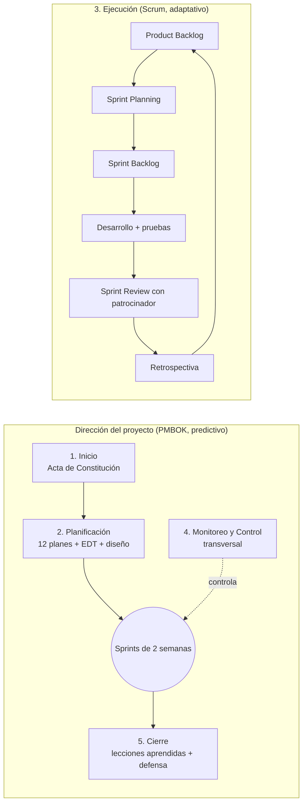

# Metodología del proyecto — Híbrida PMBOK + Scrum

**Proyecto:** Befine Store · **Equipo:** Grupo N3 (Plaxi Solutions) · **Versión:** 1.1 (09-oct-2026)

## 1. Metodología declarada

El proyecto usa una **metodología híbrida**:

- **PMBOK (enfoque predictivo)** para **dirigir** el proyecto: Inicio, Planificación, Monitoreo y Control, y Cierre. Tiene hitos fijos, líneas base (alcance, cronograma y costo) y 12 planes de gestión consolidados en el Plan de Dirección del Proyecto.
- **Scrum (enfoque adaptativo)** para **construir** el producto en la fase de Ejecución: sprints de 2 semanas, Product Backlog priorizado, Sprint Review con el patrocinador y retrospectivas.

## 2. ¿Por qué híbrida? (justificación)

| Característica del proyecto | Consecuencia | Qué lo resuelve |
|---|---|---|
| **Plazo académico fijo** de 18 semanas con hitos evaluados por Duoc UC | Se necesitan fechas comprometidas y líneas base controlables | PMBOK: cronograma con hitos, control de cambios formal |
| **Cliente real** (Befine) cuyas reglas de negocio se descubren al construir (cupones, puntos, reparto) | Los requisitos detallados cambian; un plan 100 % cerrado generaría retrabajo | Scrum: backlog repriorizable y validación quincenal con el patrocinador |
| **Riesgo de ampliación de alcance** (el patrocinador es el dueño del negocio) | Hay que absorber ideas nuevas sin perder el plazo | PMBOK: Solicitud de Cambio (SC). Scrum: lo nuevo entra al backlog, priorizado contra el plazo |
| **Equipo pequeño con disponibilidad vespertina** | Se necesitan entregas cortas y visibles | Scrum: sprints de 2 semanas y tablero Kanban en GitHub Projects |
| **Integraciones críticas** (Mercado Pago, OpenFactura/SII) | Se debe validar temprano y de forma incremental | Scrum: incrementos validables. PMBOK: registro de riesgos (R2, R5) |

**Alternativas descartadas.** *Cascada pura*: se descartó porque obliga a cerrar todos los requisitos antes de construir, y el negocio ya demostró que cambia (SC-02 cambió la tecnología del frontend en la semana 7). *Scrum puro*: se descartó porque la asignatura exige una gestión formal con planes, costos y riesgos, y porque Scrum por sí solo no entrega líneas base de costo ni gestión de adquisiciones.

## 3. Cómo se aplica en la práctica

| Elemento | Práctica del equipo | Evidencia en el repositorio |
|---|---|---|
| Roles Scrum | **Product Owner:** Iván Rodríguez (dueño de Befine). **Scrum Master / líder de sprint:** rotativo (Felipe S1, Iván S2, Carlos S3, Felipe S4). **Equipo de desarrollo:** los integrantes que no ejercen de Scrum Master, full-stack | `03-Scrum/` |
| Sprint | 2 semanas. S1: 21-sep a 04-oct · S2: 05 a 18-oct · S3: 19-oct a 01-nov · S4: 02 a 14-nov | `03-Scrum/Sprint_Backlog_*.md` |
| Product Backlog | 31 historias de usuario trazadas a los 25 RF; HU-01 a HU-15 son issues del tablero Kanban de GitHub Projects (etiquetas de área y prioridad, hito por sprint) y HU-16 a HU-31 se crean como issues en el Sprint 2 | `03-Scrum/Product_Backlog.md` |
| Definition of Done | Criterios comunes para cerrar una historia | `03-Scrum/Definition_of_Done.md` |
| Sprint Review | Validación del incremento con el patrocinador al cierre de cada sprint | Sprint Backlog (sección Review) |
| Retrospectiva | Qué funcionó, qué no y acciones de mejora | `03-Scrum/Retrospectivas/` |
| Control de cambios (PMBOK) | Todo cambio a una línea base pasa por una Solicitud de Cambio | SC-01 (presupuesto), SC-02 (frontend), SC-03 (seguridad y roles) y SC-04 (plan de Supabase) en `08-Gestion-PMBOK/` |
| Monitoreo (PMBOK) | Revisión semanal de avance frente a la línea base; registro de riesgos | Informe de Avance, sección 2 |

## 4. Equivalencia entre artefactos Scrum y PMBOK

| Scrum | PMBOK (Plan de Dirección) |
|---|---|
| Product Vision | Acta de Constitución (propósito, objetivos, indicadores de éxito) |
| Product Backlog | Plan de Gestión de Requerimientos + EDT (Anexo A) + matriz de trazabilidad |
| Sprint Backlog | Plan de Gestión del Cronograma (fase de Ejecución) |
| Definition of Done | Plan de Gestión de la Calidad (KPI y criterios de aceptación) |
| Retrospectiva | Registro de lecciones aprendidas (Plan de Dirección, Cierre) |
| Cambio de prioridad en backlog | Plan de Gestión de Cambios (si afecta líneas base) |
