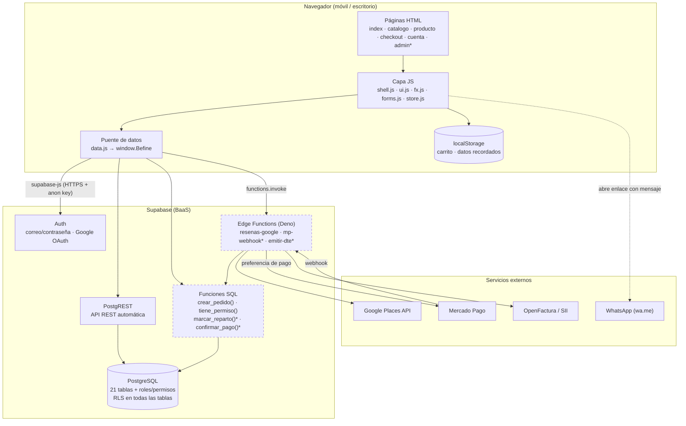
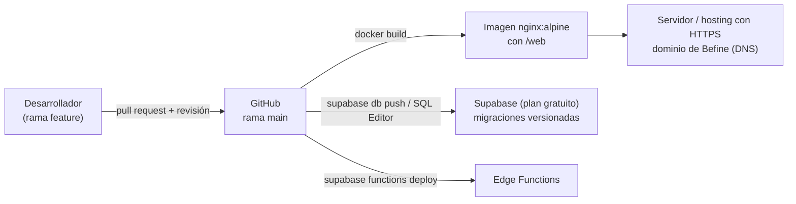

# Arquitectura de la solución — Befine Store

**Versión:** 2.0 (09-oct-2026, posterior a la SC-02) · **Responsables:** Carlos Fuentes (datos/backend) · Felipe Moraga (frontend)

## 1. Estilo arquitectónico

**Cliente web estático + Backend as a Service (BaaS).**

- **Frontend:** sitio **multipágina** en HTML5, CSS3 y JavaScript *vanilla* (una página por pantalla), **sin herramienta de build**. Se sirve como archivos estáticos (nginx en Docker o hosting estático con HTTPS).
- **Backend:** **Supabase** = PostgreSQL 15 + Auth + Row Level Security (RLS) + Edge Functions (Deno) + Storage.
- **Integraciones:** Mercado Pago (cobro), OpenFactura/Haulmer (DTE ante el SII), Google Places (reseñas) y WhatsApp (enlace `wa.me`).

El navegador consulta Supabase directamente con la **clave pública *anon***. La seguridad **no** depende del frontend: la aplica la base de datos con **RLS** y **funciones `SECURITY DEFINER`** que validan permisos. Las operaciones con secretos (pagos, DTE, reseñas) viven en **Edge Functions**, donde las claves se guardan como *secrets*.

## 2. Diagrama de componentes

\* Componentes en construcción (Sprint 3–4) o escritos y pendientes de aplicar.

## 3. Capas del frontend

| Capa | Archivos | Responsabilidad |
|---|---|---|
| Presentación | `*.html`, `css/tokens.css → base.css → components.css → shell.css → <página>.css` | Estructura semántica y estilos por capas; la marca se cambia solo en `tokens.css` |
| Interacción | `shell.js`, `ui.js`, `fx.js`, `water.js`, `bands.js`, `scenes.js`, `transitions.js` | Navbar/footer compartidos, carrito *drawer*, efectos (agua reactiva, escenas por horario) |
| Lógica de página | `home.js`, `catalogo.js`, `producto.js`, `checkout.js`, `cuenta.js` | Orquesta cada pantalla |
| Utilidades | `forms.js`, `store.js`, `perf.js` | Validación chilena (RUT, celular), estado del carrito, ajuste de rendimiento según el dispositivo |
| Acceso a datos | `data.js` (`window.Befine`) | **Único** punto que habla con Supabase; la UI nunca consulta tablas directamente |

**Regla de diseño:** toda la interfaz depende de `window.Befine`. Cambiar el origen de un dato (de un arreglo local a Supabase, o de una tabla a una función) no obliga a tocar las pantallas.

## 4. Seguridad por diseño

| Amenaza | Control |
|---|---|
| Un cliente manipula el precio o el total desde el navegador | Inserción directa en `pedidos`/`detalle_pedido` **cerrada**; solo `crear_pedido()` crea pedidos y recalcula precios, despacho y cupones desde la BD |
| Un cliente se marca un pago como aprobado o se regala puntos | `pagos`, `documentos_tributarios` y `movimientos_puntos` solo se escriben con `service_role` (webhook) |
| Un usuario se asigna el rol admin | El rol no lo elige el usuario; un trigger bloquea el auto-escalamiento de rol, nivel o puntos |
| Un chofer ve más de lo necesario | Permiso `pedidos.ver` / `pedidos.repartir`; política `direcciones_reparto` limitada a los pedidos |
| Exposición de secretos | Solo la clave *anon* (pública por diseño) en el código; `service_role`, Mercado Pago, OpenFactura y Google como *secrets* de Edge Functions; `.env` en `.gitignore` |
| XSS | Toda salida dinámica pasa por `esc()`; `textContent` en lugar de `innerHTML` para datos del usuario |
| Redirección abierta | `cuenta.html?volver=` solo acepta páginas propias (`^[\w-]+\.html$`) |

## 5. Despliegue

- **Ambientes:** local (Docker o Live Server) → producción (Supabase, plan gratuito por decisión del cliente — SC-04 — + hosting). Las migraciones se aplican en orden y cada una tiene su script de reversa.
- **Configuración:** las variables de cada ambiente se describen en `.env.example` (nunca se sube `.env`).

## 6. Decisiones de arquitectura (ADR resumidos)

| # | Decisión | Alternativas | Motivo |
|---|---|---|---|
| ADR-01 | Supabase como backend | Backend propio (Node/Express) | Auth, RLS y API listos; el equipo concentra las 18 semanas en el producto |
| ADR-02 | HTML/CSS/JS en lugar de Flutter Web (SC-02) | Flutter Web, React | Carga liviana, SEO y control total de la experiencia; sin curva de Dart |
| ADR-03 | Sin bundler (sin Vite) | Vite / Webpack | Simplicidad para un equipo de 3; se puede incorporar después sin rehacer el código |
| ADR-04 | Lógica de dinero en el servidor (`crear_pedido`, `confirmar_pago`) | Calcular en el navegador | El navegador no es confiable para precios, pagos ni puntos |
| ADR-05 | Roles y permisos en tablas (RBAC configurable) | `enum` fijo de roles | El dueño puede crear roles nuevos sin cambiar el código |
| ADR-06 | Avisos por enlace `wa.me` en el MVP | API WhatsApp Business | La API exige verificación de Meta y plantillas aprobadas; queda como trabajo futuro |
