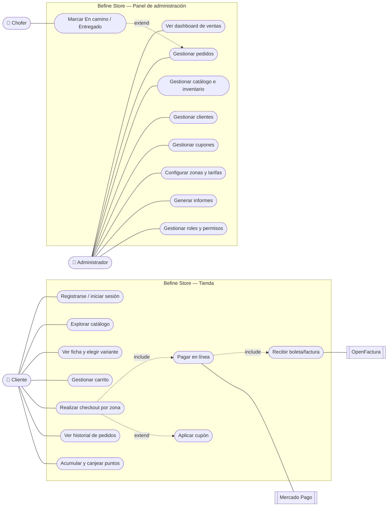
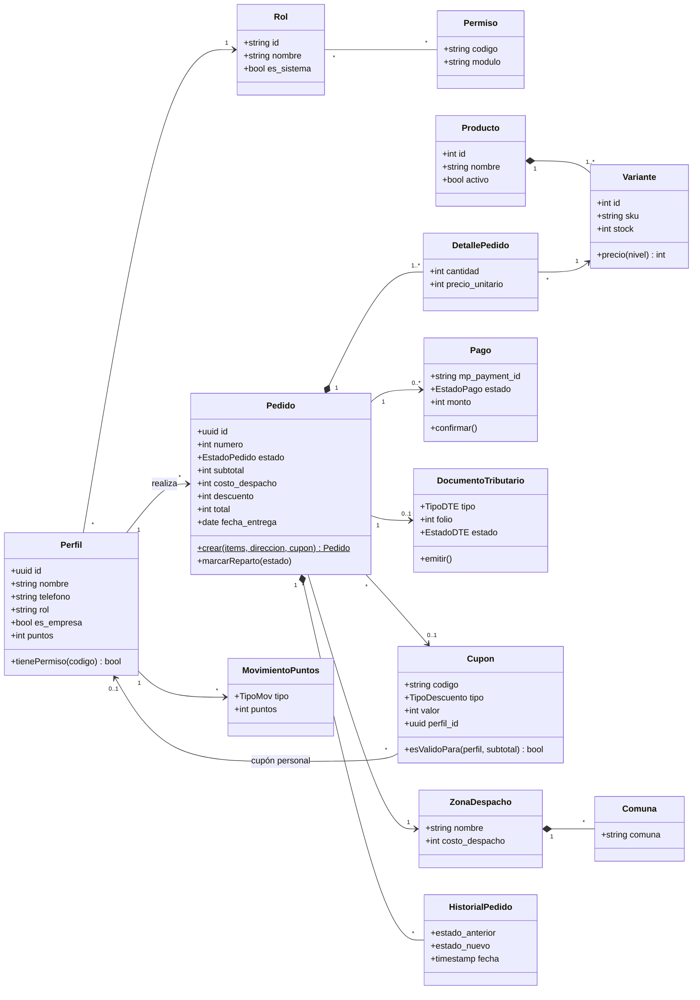
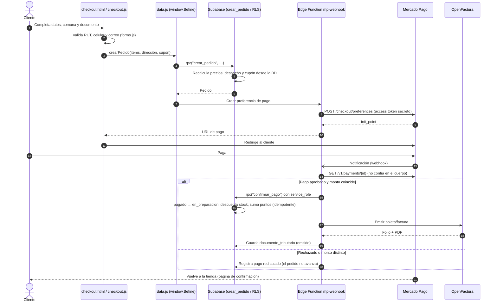
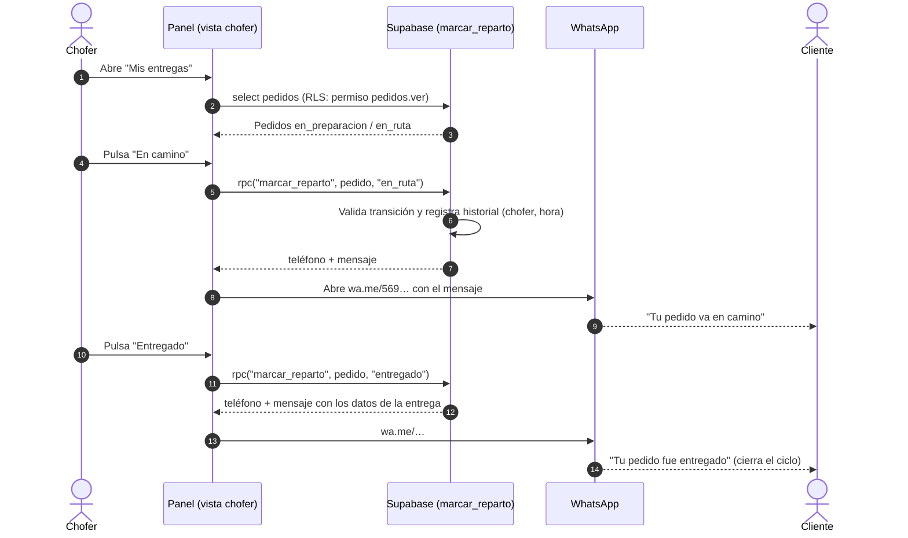
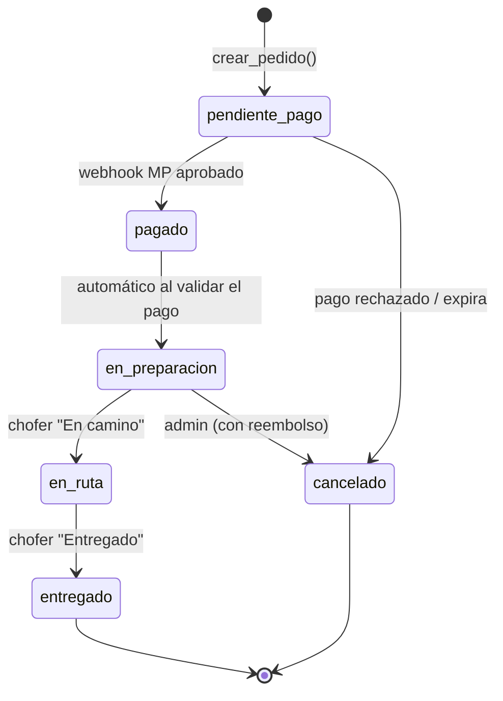
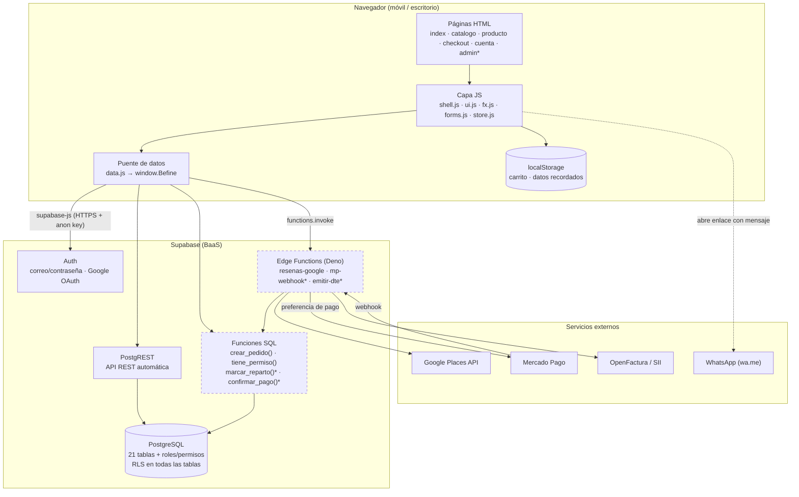

# Diagramas UML — Befine Store

**Versión:** 1.0 (09-oct-2026). Los diagramas están en **Mermaid** y se dibujan directamente en GitHub.

Contenido: 1) Casos de uso · 2) Clases del dominio · 3) Secuencia: compra y pago · 4) Secuencia: reparto y aviso por WhatsApp · 5) Estados del pedido · 6) Componentes.

---

## 1. Diagrama de casos de uso

Actores: **Visitante/Cliente**, **Administrador**, **Chofer** y los sistemas externos **Mercado Pago** y **OpenFactura**.

| Caso de uso | RF | Actor principal | Precondición | Postcondición |
|---|---|---|---|---|
| Realizar checkout por zona | RF-06 | Cliente | Carrito con al menos 1 ítem | Pedido en `pendiente_pago` creado por `crear_pedido()` |
| Pagar en línea | RF-07 | Cliente / Mercado Pago | Pedido en `pendiente_pago` | Pago `aprobado` y pedido en `en_preparacion` |
| Recibir boleta/factura | RF-08 | OpenFactura | Pago aprobado | DTE `emitido` y PDF disponible |
| Marcar En camino / Entregado | RF-09, RF-16 | Chofer | Pedido `en_preparacion` o `en_ruta` | Estado actualizado, historial registrado, aviso por WhatsApp |
| Gestionar roles y permisos | RF-02 | Administrador | Sesión con rol admin | Rol nuevo con sus permisos |

---

## 2. Diagrama de clases (modelo de dominio)

Vista conceptual de las entidades principales del [modelo de datos](Modelo_Datos_Befine_Store.md) (21 tablas + roles y permisos) y sus operaciones de negocio.

---

## 3. Diagrama de secuencia — Compra y pago con Mercado Pago

---

## 4. Diagrama de secuencia — Reparto y aviso por WhatsApp

---

## 5. Diagrama de estados — Pedido

Cada transición queda en `historial_pedido` (RNF-09). Las transiciones del chofer están limitadas por `marcar_reparto()`: solo `en_preparacion → en_ruta → entregado`.

---

## 6. Diagrama de componentes

Componentes de la solución y sus dependencias (detalle de capas y seguridad en [Arquitectura.md](Arquitectura.md)).

\* Componentes en construcción (Sprints 3–4) o escritos y pendientes de aplicar.
