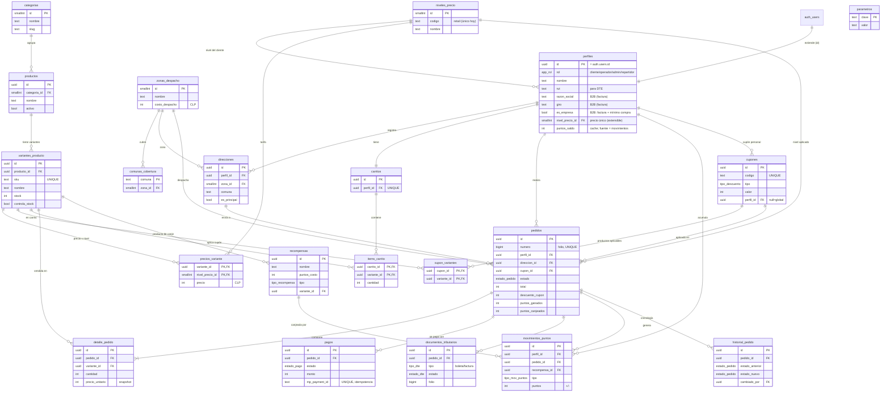

# Befine Store — Modelo de datos relacional (Supabase / PostgreSQL)

Grupo N3 · Capstone APT · **v2.0 (definitiva) · 16-sep-2026**. Refleja la base realmente desplegada en Supabase. Scripts fuente: `befine_store_schema_DEFINITIVO.sql` (estructura + seguridad) y `befine_store_catalogo_DEFINITIVO.sql` (datos).

## 0. Supuestos de diseño (declararlos ante la comisión)

1. **Identidad sobre `auth.users` de Supabase.** No creamos tabla de contraseñas: la autenticación (RF-01/02) la maneja Supabase Auth. `perfiles` extiende `auth.users` (misma PK `uuid`), así `auth.uid()` sirve directo en las políticas RLS.
2. **Precio único por producto**, con `niveles_precio` extensible. Hoy hay un solo nivel (retail); modelar el precio como fila (`precios_variante(variante_id, nivel_precio_id, precio)`) permite agregar un nivel a futuro con un `INSERT`, sin cambiar el esquema.
3. **B2B = facturación + mínimo de compra, no precio.** El cliente empresa (`perfiles.es_empresa`) paga lo mismo; se distingue por emitir factura (`razon_social`/`giro`) y tener un mínimo de recargas por pedido (`parametros.b2b_minimo_recargas`).
4. **Clientes legacy vía cupón**, no vía precio por cliente: un cupón que aplica a un producto específico resuelve el precio histórico sin etiquetar cliente por cliente.
5. **Montos en CLP como `integer`** (el peso no usa decimales): evita errores de redondeo.
6. **Carrito separado de pedidos** para no contaminar las métricas de venta con carritos abandonados.
7. **Pagos, DTE y puntos se escriben server-side** (webhook / Edge Function con `service_role`); el cliente solo los lee.

## 1. Diagrama entidad-relación

**Cardinalidades clave:** un producto tiene N variantes; cada variante tiene un precio por nivel; un pedido tiene 1..N líneas (`||--|{`), 0..N pagos (reintentos) y 0..N documentos tributarios; un cliente tiene 1 carrito activo (`perfil_id` UNIQUE); una comuna pertenece a una zona.

## 2. Estructura (SQL)

Las 21 tablas, tipos, funciones, triggers, índices y RLS se crean con `befine_store_schema_DEFINITIVO.sql`. El catálogo real y el cupón legacy se cargan con `befine_store_catalogo_DEFINITIVO.sql`. Ambos se ejecutan en Supabase → SQL Editor, en ese orden.

## 3. Políticas RLS

Patrón: **el cliente solo ve/toca lo suyo; el staff (admin/operador) ve todo.** La función `es_admin()` (SECURITY DEFINER, evita recursión) es el discriminador. Catálogo y configuración: lectura pública, escritura solo staff. `pagos`, `documentos_tributarios` y `movimientos_puntos`: el cliente solo lee lo suyo; las escrituras las hace el server (`service_role`, que omite RLS), así un cliente nunca puede marcarse un pago aprobado ni regalarse puntos. Un trigger impide que un cliente se auto-escale rol/nivel/puntos al editar su perfil.

## 4. Justificación de decisiones (para la defensa individual)

**Identidad sobre `auth.users`:** Supabase ya gestiona credenciales y recuperación de clave; duplicar eso sería reinventar (y arriesgar) la seguridad. `perfiles` comparte la PK con `auth.users`.

**Rol como `enum`, no tabla N:M:** para el MVP los roles son mutuamente excluyentes (cliente, operador, admin, repartidor); un enum es más simple y autoexplica los valores válidos.

**Precio único, con niveles extensibles:** hoy todos pagan el mismo precio (retail). Se modela como fila (`precios_variante(variante_id, nivel_precio_id, precio)`) y no como columna, para poder agregar un nivel a futuro con un `INSERT`, sin alterar la tabla. El **B2B no es un nivel de precio**: el cliente empresa (`es_empresa`) paga lo mismo y se distingue por emitir factura y tener un mínimo de compra (`b2b_minimo_recargas`).

**Legacy por cupón y no por precio-cliente:** el negocio tiene pocos clientes legacy y no quiere identificarlos uno a uno. El cupón `LEGACY2000` (20% sobre la Recarga 20L con envase Befine) lleva ese producto de $2.500 a $2.000 **en cualquier cantidad** (por eso porcentaje y no monto fijo). Por eso se agregó `cupon_variantes` (productos aplicables, RF-20) y se eliminó la tabla `precios_cliente`: un modelo más limpio.

**Producto vs. variante:** un producto se vende en formatos con SKU, stock y precio propios. La variante es la unidad vendible; el carrito y el detalle apuntan a la variante.

**Carrito separado del pedido:** un carrito abandonado no es una venta; separarlo mantiene `pedidos` con solo transacciones reales (dashboard limpio).

**`detalle_pedido.precio_unitario` (snapshot):** un pedido ya emitido conserva el precio con que se cobró y boleteó, aunque el catálogo cambie después.

**`mp_payment_id` UNIQUE (idempotencia):** Mercado Pago puede llamar al webhook varias veces por el mismo pago; la restricción evita duplicarlo.

**DTE separado de pagos:** se puede pagar sin emitir aún el documento, o reintentar la emisión si OpenFactura rechaza. `UNIQUE(tipo, folio)` refleja la unicidad del folio ante el SII.

**Puntos como libro mayor (ledger) + recompensas (estilo COPEC):** `movimientos_puntos` registra cada acumulación/canje como fila firmada (auditable); `perfiles.puntos_saldo` es solo un cache mantenido por trigger. El canje no es descuento directo: se canjea por una **recompensa** del catálogo (`recompensas`), que entrega un cupón o un producto — tal como el sistema de puntos de COPEC.

**Cronología automática:** `historial_pedido` se llena con un trigger cada vez que cambia el estado del pedido; la trazabilidad no depende de que el programador la escriba a mano.

**Zonas + comunas + parámetro de envío gratis:** `Quilicura` es zona de costo $0; el resto (`Sector Norte`) $2.500; `comunas_cobertura` valida cobertura en el checkout; el umbral de envío gratis ($7.000) vive en `parametros`, no "quemado" en el código.

**RLS desde el día 1:** con Flutter Web el cliente habla directo a Supabase con la `anon key`; sin RLS cualquiera leería pedidos ajenos. Es la línea de defensa real (seguridad + Ley 21.719).

## 5. Matriz de trazabilidad RF → tabla(s)

| RF | Requerimiento | Tablas / mecanismo |
|----|---------------|--------------------|
| RF-01 | Registro de cliente | `auth.users` + `perfiles` (trigger `handle_new_user`) |
| RF-02 | Autenticación y roles | `perfiles.rol` (enum `app_rol`) + RLS |
| RF-03 | Explorar catálogo | `productos`, `variantes_producto`, `precios_variante`, `categorias` |
| RF-04 | Ficha y variante | `productos`, `variantes_producto`, `precios_variante` |
| RF-05 | Carrito | `carritos`, `items_carrito`; envío gratis → `parametros` |
| RF-06 | Checkout por zona | `direcciones`, `zonas_despacho`, `comunas_cobertura`, `pedidos` |
| RF-07 | Pago Mercado Pago | `pagos` |
| RF-08 | Emisión DTE | `documentos_tributarios` |
| RF-09 | Notificaciones de estado | `historial_pedido` (cronología); envío → Edge Function |
| RF-10 | Historial de pedidos | `pedidos`, `detalle_pedido`, `historial_pedido`, `documentos_tributarios` |
| RF-11 | Fidelización por puntos | `movimientos_puntos`, `recompensas`, `parametros` |
| RF-12 | Contenido institucional y zonas | `zonas_despacho`, `comunas_cobertura`; páginas → *pendiente* `paginas` |
| RF-13 | Formulario de contacto | *pendiente* `mensajes_contacto` |
| RF-14 | Suscripción a novedades | *pendiente* `suscriptores` |
| RF-15 | Dashboard de métricas | consultas sobre `pedidos`/`pagos`/`perfiles` (sin tabla nueva) |
| RF-16 | Gestión de pedidos | `pedidos`, `historial_pedido`, `estado_pedido`; reembolso → `estado_pago` |
| RF-17 | Catálogo y variantes (admin) | `productos`, `variantes_producto`, `precios_variante` |
| RF-18 | Inventario | `variantes_producto.stock`, `controla_stock` |
| RF-19 | Clientes y segmentos | `perfiles` (rol, `es_empresa`, razón social/giro); segmentos avanzados *pendiente* |
| RF-20 | Descuentos y cupones | `cupones`, `cupon_variantes` |
| RF-21 | Zonas y tarifas | `zonas_despacho`, `comunas_cobertura`, `parametros` |
| RF-22 | Config. medios de pago | `parametros`; credenciales en secrets, no en tabla |
| RF-23 | CMS de contenido | *pendiente* `paginas` |
| RF-24 | Informes y reportes | consultas (sin tabla nueva) |
| RF-25 | Importación/exportación CSV | operación sobre `productos`/`perfiles` (sin tabla nueva) |

Las tablas marcadas *pendiente* (RF-13, RF-14, RF-23) son de prioridad 3 y **no están en las 14 HU del backlog**; se agregan más adelante **sin modificar** el núcleo ya construido.

## 6. Pendiente

Definir recompensas de puntos y la regla de acumulación; crear usuario admin; migrar clientes reales; tablas periféricas RF-13/14/23 cuando corresponda. (Datos de conexión en `Conexion_Supabase_Befine.md`.)

---

## Actualización v2.1 — Migración `20261009_01_seguridad_roles` (09-oct-2026)

Scripts en esta carpeta: `SQL/01_befine_store_schema.sql` (estructura v2.0), `SQL/02_befine_store_catalogo.sql` (datos reales) y `SQL/03_migracion_20261009_01_seguridad_roles.sql` (este cambio; su reversa está en el repositorio de código, `supabase/migrations/`).

| Cambio | Detalle |
|---|---|
| **RBAC configurable** | Nuevas tablas `roles`, `permisos` y `rol_permisos`. `perfiles.rol` pasa del `enum app_rol` a `text` con FK a `roles`. Roles de sistema: `cliente`, `admin` y `chofer`; el admin puede crear roles nuevos y asignarles permisos. |
| **Función `tiene_permiso(codigo)`** | Todas las políticas RLS de escritura del staff pasan de `es_admin()` a permisos granulares (`catalogo.gestionar`, `pedidos.ver`, `promociones.gestionar`, etc.). |
| **Pedidos solo desde el servidor** | Se cierra el `INSERT` directo en `pedidos` y `detalle_pedido`; `crear_pedido()` toma precios, despacho y cupones desde la BD. El estado `pagado` lo marca solo el webhook (migración 03). |
| **Pedido con contacto y entrega** | Se agregan el contacto (para WhatsApp), la fecha de entrega y el tipo de documento (boleta/factura). |
| **Cupones generales y personales** | `cupones.perfil_id` NULL = cupón para todos; con valor = solo para ese cliente. Se validan en el servidor. |

**Migraciones escritas, pendientes de aplicar:** `02_reparto_whatsapp` (permiso `pedidos.repartir` y función `marcar_reparto`) y `03_invitados_pago` (compra como invitado y `confirmar_pago` idempotente para el webhook de Mercado Pago).
